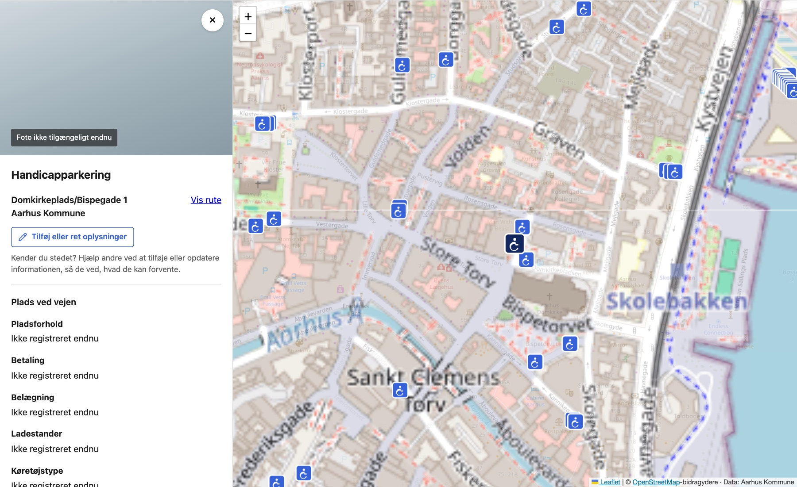
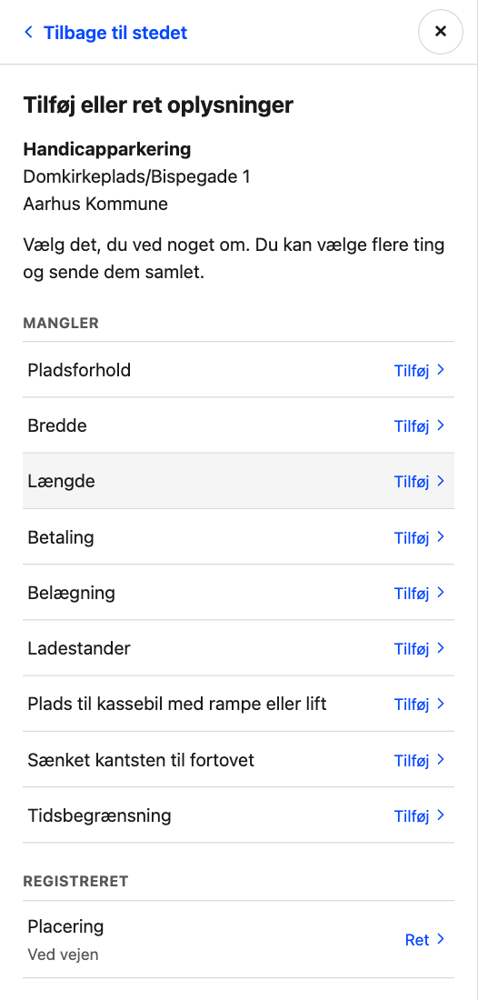
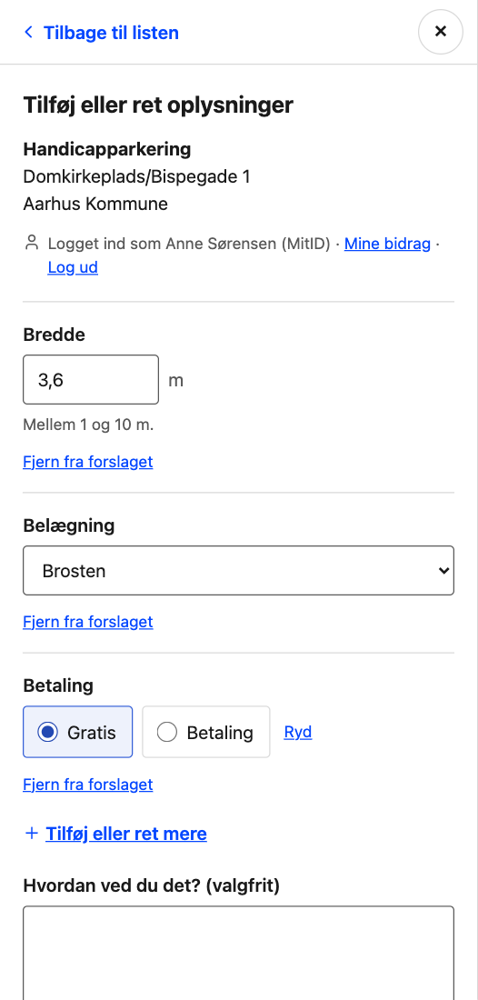
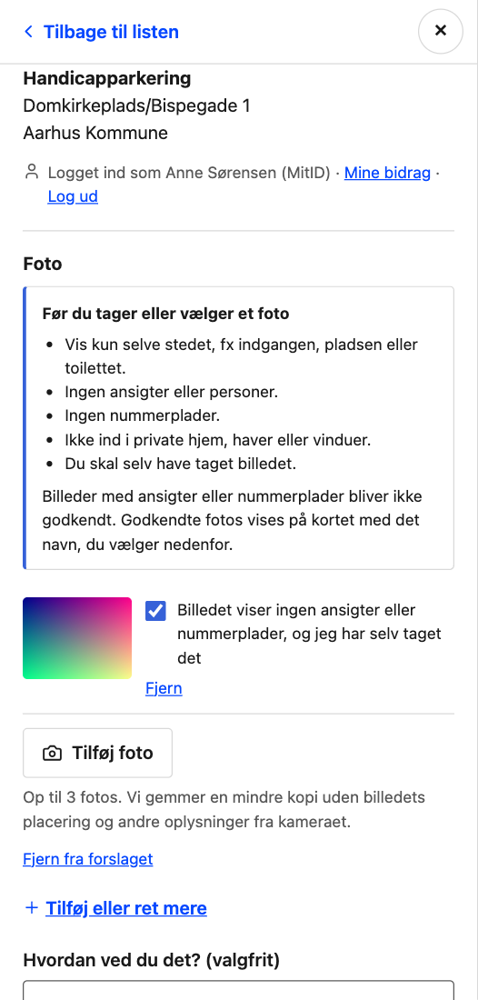
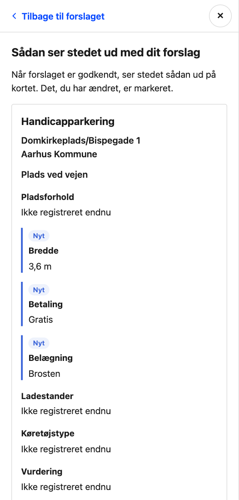
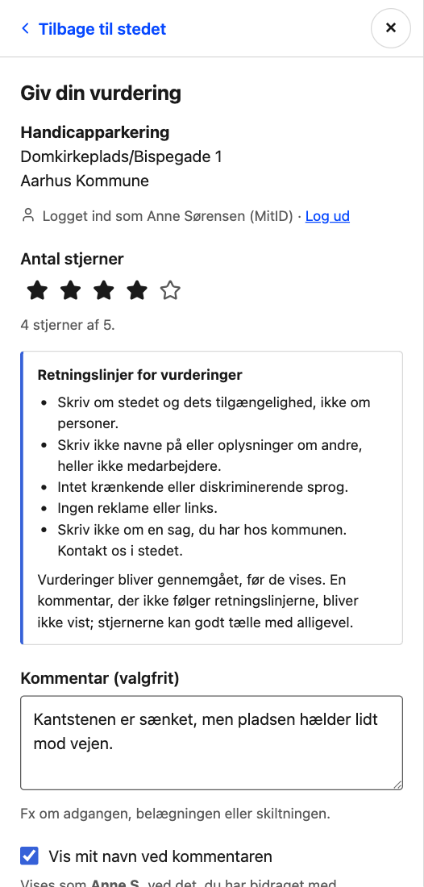
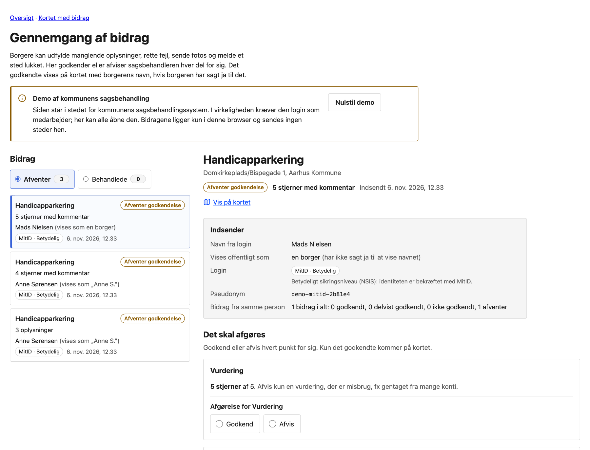
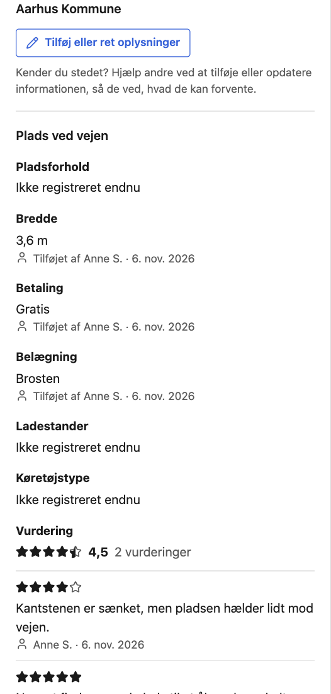

# Collecting information from citizens

`bidrag.html` and `bidrag-gennemgang.html` show how citizens could add what the
sources leave out, and how the municipality could check it before it goes on
the map. Everything behind the pages is a mock; this document says what the
mock stands in for.

## What it looks like

| | |
| --- | --- |
|  | The place, as on the other maps, with one way in. |
|  | What is missing, what is registered, and a photo, closure or message. |
|  | Several things in one suggestion, each with a way out. |
|  | Photo rules first, a confirmation per photo. |
|  | The preview before sending. |
|  | A rating, with the guidelines for comments. |
|  | The back office: who sent it, and a decision per item. |
|  | Approved: values credited, ratings averaged, comments shown. |

## Why

The gaps are large, and they are in the information people ask for:

| Source | Attribute | Missing |
| --- | --- | --- |
| `merged-handicap-parking-spots` (1251) | `additionalInformation.fee` | 1238 |
| | `additionalInformation.surface` | 1213 |
| | `width`, `length` | 1251 |
| `merged-public-toilets` (174) | `openingHours` | 155 |
| | `babyChange` | 134 |
| | `address` | 123 |
| | `wheelchairAccessible` | 84 |
| `osm-bench` (2287) | `seats` | 2197 |
| | `armrest` | 1564 |

## The flow

Modelled on Google Maps'
[Suggest an edit](https://support.google.com/maps/answer/7084895): say what
you know something about, sign in, add what is missing or correct what is
wrong, and the edit is reviewed before it is published.

- **The place stays calm.** It reads as on the other maps, with one button,
  "Tilføj eller ret oplysninger", and one line when the user has suggestions
  waiting. Credits for approved contributions stay under the values.
- **A list first.** The button opens everything that can be added or
  corrected: what is missing, what is registered (with its value now), a
  photo, a closure report, and a message. A row the user already has a
  suggestion waiting for says so.
- **MitID only, when it is needed.** The list needs no login; picking a row
  does, once. There is no user name and password, so every contribution comes
  with an identity verified at a substantial assurance level.
- **Several things in one suggestion.** The form shows what was picked, each
  with "Fjern fra forslaget", and "Tilføj eller ret mere" goes back to the
  list. A registered value starts from what it is now, and may be marked wrong
  without giving the right one; approved, that removes the value. A field that
  depends on another, the amount on a paid toilet, appears under it.
- **Empty means "don't know".** There is no "Ved ikke" option. A choice already
  made has a "Ryd" button.
- **Controls follow the number of options.** Up to 3 are radio buttons, up to
  10 a select; more would need a select with search. No field has more than 7.
  The list of what can be added is links into the form, not a choice, so the
  rule does not apply to it.
- **Preview.** Before sending, the place is shown as it will look once
  approved, with each change marked "Nyt", "Ændret" or "Fjernes" and the old
  value under it.
- **Receipt and "Mine bidrag".** The contributor sees the status of each value
  and photo, and the reason when one is rejected.
- **Nothing typed is lost.** Errors are shown at the field and the input stays.
  Going back to the list, closing the form, opening another place or logging
  in keeps the draft for as long as the page is open. Logging out discards it,
  so the next person on the same browser does not see it.

Opening hours are entered per weekday (open with times, closed, or open 24
hours) and stored in OpenStreetMap's `opening_hours` syntax, which is what the
toilet sources already use: `Mo-Fr 08:00-18:00; Sa off; Su 00:00-24:00`.

## What can be contributed

Each model file lists its `fields` next to `describe`:

| Model | Fields |
| --- | --- |
| ParkingSpot | description (`Pladsforhold`), width, length, placement (`category`), fee, surface, charging point, room for a van with ramp or lift, lowered kerb, time limit |
| PublicToilet | name, address, wheelchair access, access, free or paid and the amount, opening hours, baby changing table |
| Bench | backrest, armrests, room to lie down, material, number of seats |

Only `description`, `width`, `length` and `category` are ParkingSpot
attributes in the Smart Data Model. The rest go in `additionalInformation`,
where Enter already keeps `fee` and `surface`; `chargingPoint`,
`vanAccessible`, `loweredKerb` and `maxStay` are names chosen here. Whether
they belong there, or in an extended model, is for Enter to decide.

## Photos

The rules are shown before a photo is chosen: only the place, no faces or
people, no licence plates, nothing private, and taken by the contributor. Each
photo needs a ticked confirmation, and the review page shows the photo large
enough to check. At most three per contribution.

In the browser each photo is redrawn at most 1600 px on its long edge and saved
as JPEG. That also drops its EXIF data, the GPS position included.

## Ratings

Every place has a "Vurdering" section: the average of the approved ratings,
how many there are, the three newest approved comments, and five stars to give
one's own. On parking it takes the place of the "Vurdering: Ikke registreret
endnu" row the other pages show; on toilets and benches it sits above the
source.

- **Stars first, then the login.** A star chosen with the pointer goes
  straight on, to MitID the first time and then to the rating form. With the
  keyboard the arrow keys move the choice, and Enter or "Fortsæt" goes on.
- **The form** holds the stars (changeable), the guidelines, an optional
  comment and "Vis mit navn ved kommentaren". The guidelines: write about the
  place and its accessibility, not about people; no names of or information
  about others, employees included; nothing offensive or discriminating; no
  advertising or links; no personal case with the municipality.
- **Reviewed before it shows.** The stars and the comment are reviewed
  separately, so a comment that breaks the guidelines can be rejected while
  the stars count. The reason reaches the contributor under "Mine bidrag".
- **One person, one rating per place.** The newest approved rating counts; a
  new one replaces the old once it is approved. The stars count without a
  name; a comment is credited like other contributions.
- **The stars are radio buttons**, five options styled as stars: a choice of
  4–10 options would otherwise be a select, but a rating is a scale the user
  points at, and a radio group keeps it keyboard- and screen reader-operable.
- **The stars are in the text colour**, not gold: the accent marks primary
  actions and the status colours are taken.

## Attribution

A contribution records who gave it, in two ways:

- **Thanks, in public.** Each approved value and photo is credited on the
  place: "Tilføjet af Anne S. · 5. nov. 2026", "Rettet af …", "Foto: …". The
  name is shown only if the contributor ticks "Vis mit navn"; otherwise it
  reads "en borger". The source line of the place adds "Og borgerbidrag".
- **Provenance, for the municipality.** The record keeps the pseudonymous
  subject from the login, the full name, the login method and its assurance
  level, the time, the old and new value, and who decided and when. The review
  page shows all of it, with the contributor's earlier contributions and how
  many were approved. The form says this is kept whether or not the name is
  shown.

The record shape is documented at the top of `public/js/contributions.js`.

## What is mock, and what production needs

| Here | In production |
| --- | --- |
| "MitID" picks one of two made-up people | MitID through NemLog-in (OpenID Connect), which needs the municipality's service provider agreement. Ask for the pseudonym and the name, not the CPR number. |
| Contributions in the browser's IndexedDB, tabs synced with a BroadcastChannel | An API in front of Enter that stores contributions and photos, limits how often one person can contribute, and checks input on the server. |
| Anyone can open the review page | Staff login, and a decision on who reviews which data, how fast, and how the contributor hears the result. |
| Approved values laid over the snapshot in the browser | Citizen contributions as a source of their own in Enter, merged like OpenStreetMap and MTM, with provenance on each attribute: NGSI-LD properties of properties (who, when) or a `datasetId` per source. Enter also has to decide which source wins when a register and a citizen disagree. |
| EXIF dropped in the browser | Also dropped on the server, which cannot trust the browser. Faces and licence plates blurred automatically before a person reviews the photo; the browser's `FaceDetector` is not generally available. |
| Photo rules shown, not enforced | A licence for published photos (for example CC BY 4.0 under the display name, or rights to the municipality), and a way to withdraw a photo. |
| Consent to show the name is a checkbox | A legal basis under GDPR for keeping the identity, a retention period, and a way to withdraw consent to the name being shown. |

## Limits of the demo

- A draft lives in memory: reloading the page loses it.
- A place shows the newest approved photo, with a count when there are more.
- An approved closure puts a notice on the place; the place stays on the map.
- A message ("Andet") is reviewed but not shown on the map.
- A place shows the three newest approved comments and says how many there
  are; there is no way to read the rest, sort or report a comment.
- Nothing tells a contributor that a decision was made; they find it under
  "Mine bidrag".
